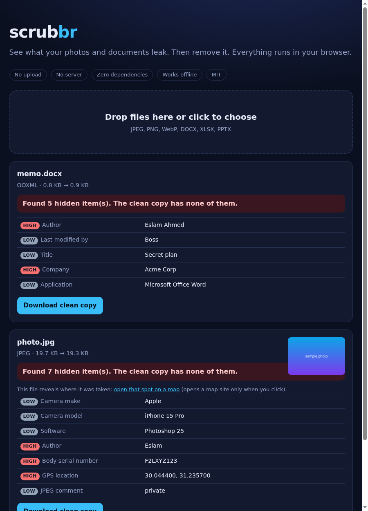

# scrubbr

**See what your photos and documents leak. Then remove it. Nothing leaves your device.**



A photo from your phone can carry the GPS spot where you took it, the phone model, and a serial number. A Word file can carry your name, your company and who last edited it. scrubbr shows you all of that first, then gives you a clean copy.

- **Shows, then removes.** Every hidden item is listed with a risk level before you download anything.
- **100% local.** No upload, no server, no tracking. Open DevTools and watch the Network tab stay empty.
- **Zero dependencies.** One small JS module. Works in the browser, in Node, and offline.
- **Pixels untouched.** Images are not re-encoded. Only metadata blocks are cut, so quality stays identical.
- **Verified.** Tests check the output with `exiftool`.

## Supported

| Format | Removed |
|---|---|
| JPEG | EXIF (GPS, make, model, serials, owner), XMP, IPTC/Photoshop, comments, extra APP blocks |
| PNG | tEXt/zTXt/iTXt, eXIf, tIME |
| WebP | EXIF, XMP |
| DOCX / XLSX / PPTX | author, last modified by, title, company, keywords, created/modified timestamps, revision count, custom properties, thumbnail |

Comments and tracked changes in Office files are reported but never edited, so your content is not touched. PDF support is on the roadmap.

## Use it

**Web app:** open `index.html` through any static server (ES modules need http), or use the GitHub Pages demo.

```bash
git clone https://github.com/eslam-tohamy2026/scrubbr
cd scrubbr && python3 -m http.server 8000   # then open http://localhost:8000
```

**CLI:**

```bash
node cli.mjs photo.jpg            # writes photo.clean.jpg and prints what was found
node cli.mjs memo.docx out.docx
```

**As a library:**

```js
import { scrub } from './src/scrub.js';
const { found, clean } = await scrub(new Uint8Array(buffer)); // clean is a Uint8Array
```

## Test

```bash
npm test
```

The suite uses `exiftool` to double-check the clean files when it is installed, and skips those checks with a note when it is not.

## Roadmap

- [ ] PDF (Info dict, XMP, embedded file metadata)
- [ ] MP4/MOV and audio tags
- [ ] Chrome/Edge extension: clean files right before upload
- [ ] Batch download as zip

## Limits

scrubbr removes metadata, not visible content. A face, a street sign or text inside an image is still there. Worksheet names and slide titles also stay: they are part of the document content, not metadata. Always check the clean file before sharing something sensitive.

## License

MIT
